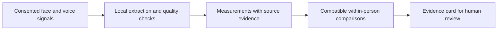

# PhenoMetrix

**Face and voice measurements from everyday video visits.**

PhenoMetrix is an open-source research prototype for measuring facial movement
and voice during telehealth conversations. It processes consented camera and
microphone signals in the browser, compares compatible observations from the
same person, and presents the measurements with their supporting evidence for
human review.

The goal is to make observations across visits easier to examine: what was
measured, under what conditions, what changed, and whether the comparison is
supported by the available data. The intended home is inside an existing
telehealth workflow. This repository contains a runnable local demonstration,
components for integrating with a host application, and experiments evaluating
voice-measurement methods.

**Status:** nonclinical research software. The project has not established
clinical measurement validity or usefulness for diagnosis or treatment decisions.
It began as the **NeuroTrax** neurological hackathon demo and is developing toward
a reusable face-and-voice measurement platform.

## Why this project exists

A video visit contains observable facial movement and voice patterns, but a
number alone does not make an observation useful. A change in a microphone,
lighting, head pose, or capture context can change a measurement. A comparison
also needs to account for which method produced each value and whether enough
usable signal was available.

PhenoMetrix makes those conditions part of the result. For example, it can
report an eye-aperture measurement, identify the periods of signal that support it,
and compare it with an eligible prior observation. If the signal is inadequate
or the observations are incompatible, it reports **not measurable** or explains
why the comparison was withheld. A numerical difference does not, by itself,
indicate improvement or worsening of health.

## What it does

The project has three capabilities:

| Capability | Purpose |
| --- | --- |
| **Ambient Capture** | Extract face and voice measurements during consented conversation, screen signal quality, and retain reasons for missing or withheld results. |
| **Personal Trajectory** | Compare a person's observations when their source, protocol, and measurement conditions are compatible; show which observations were included or excluded. |
| **Clinician Evidence Card** | Present values, differences, quality information, and source references together so a human can inspect the evidence and record a review. |

The current measurement registry contains **20 facial and 7 voice metrics**.
Examples include eye aperture, lid closure, facial asymmetry, pitch variability,
and pause timing. These are engineering measurements with explicit quality
requirements. Their presence in the registry does not establish that they measure
a disease or its severity.



## What you can use today

The local demo and encounter integration implement the same capabilities at
different levels:

| | Local demonstration | Encounter integration |
| --- | --- | --- |
| **Capture** | Camera and microphone access in a standalone browser page | Analysis attached to an authorized media stream supplied by the host telehealth application |
| **Comparison** | Two live sessions, with the first explicitly accepted as an in-memory reference | Versioned derived observations and descriptive comparisons across visits |
| **Review** | A report and six-row facial comparison card; review state lasts only for the page session | An embeddable evidence panel and a service API for authenticated review |
| **Storage** | No saved recordings or durable results | PostgreSQL history of derived observations and reviews; routine capture does not upload raw media |

The standalone demo retains its original unilateral facial-movement research
context. This explains its affected-side selector and facial comparison card;
the generic session report also contains voice measurements. The integration
code includes a narrow hemifacial-spasm treatment-alignment research protocol,
which places selected eye measurements alongside documented treatment dates.
It does not establish spasm burden or treatment effectiveness.

A deployed Zoom integration, connected electronic health record, clinical
identity system, and institutional authorization must be supplied separately.
See the [integration guide](docs/encounter-integration.md) for those boundaries.

## Try the local demo

Use **Node 22.12+ on the Node 22 line, or Node 24+**, **pnpm 9.12.3**, and
**Chrome on macOS** with hardware acceleration. Camera and microphone permissions
are independent; either modality can run when the other is unavailable. Device
access requires localhost or HTTPS. Other browser/device configurations have not
been validated.

```sh
git clone https://github.com/logannye/phenometrix.git
cd phenometrix
pnpm install --frozen-lockfile
pnpm dev
```

Open [http://127.0.0.1:4173](http://127.0.0.1:4173). No database or API key is
required for this demo. Use synthetic participant identities for development.

1. Read the research notice, select the demo's participant-asserted side, and
   consent to capture. The application does not infer or verify that side.
2. Complete camera/microphone setup and start a live conversational session.
3. End the session to see measured and withheld outcomes with their reasons.
4. Choose **Use this session as in-memory reference**, then consent to a second
   live session to inspect the comparison card.

The reference, results, and page-local review state are cleared on reset,
visibility loss, or reload. No recording is saved. The
[operator guide](docs/operator-guide.md) explains the workflow and common failures.

To explore the evidence interface without device capture, run:

```sh
pnpm dev:evidence
```

Open [http://127.0.0.1:4175](http://127.0.0.1:4175) for the **synthetic** evidence
preview. Durable history requires the separate
[encounter service and PostgreSQL setup](apps/encounter-service/README.md).

## How it is built

The application is a TypeScript monorepo. MediaPipe extracts facial landmarks
inside a browser worker; shared measurement code derives facial geometry from
those transient outputs. Voice processing uses an AudioWorklet and a worker
with bounded buffers, explicit gaps when input is lost, and stale-result checks.
**The default voice estimator uses digital signal processing (DSP).**

Shared contracts connect measurements, comparisons, and evidence cards. The
encounter service stores derived observations in PostgreSQL, preserves earlier
versions when a source is corrected, and runs descriptive analysis against a
fixed history snapshot. Host adapters supply encounter identity and consent;
FHIR R4 interfaces support imported clinical context. The
[architecture document](docs/architecture.md) explains the component contracts.

## Voice research and evidence

The voice research asks whether a small learned model can improve pitch and
voicing measurements while preserving explicit timing and failure limits.
Experiments use frozen inputs and predictions, matched comparisons, and separate
numerical/scoring audits. Learned estimators run through an opt-in research path;
they have not replaced the default DSP estimator.

The work is documented in [PR #33](https://github.com/logannye/phenometrix/pull/33)
and [PR #34](https://github.com/logannye/phenometrix/pull/34). The linked reports
below are pinned to a specific research commit and identify the source and
artifacts used for each evaluation. These are experimental models.

| Evaluation | Finding | Scope |
| --- | --- | --- |
| [Frozen speech evaluation](https://github.com/logannye/phenometrix/blob/dec24f22241ed4655023c35671f6aab226c155e6/research/voice-prosody/HYBRID_VALIDATION_RESULTS.md) | A 3,143-parameter learned-voicing/YIN-pitch hybrid achieved **9.67% joint error**, versus **11.85%** for DSP. | 160 PTDB-TUG recordings from four then-reserved speakers, under four conditions. The candidate-selecting MLP had lower error at **9.12%**, with separate known pitch failures. |
| [Natural-audio browser replay](https://github.com/logannye/phenometrix/blob/dec24f22241ed4655023c35671f6aab226c155e6/research/voice-prosody/VOICING_ROBUSTNESS_RESULTS.md#natural-browser-execution-and-delivery) | The same frozen hybrid completed audited finite replay with **5.6 ms** processed-block service p99 and **99.9571%** target delivery, and **89.7142%** delivered-correct coverage. | One predetermined source from each of eight previously used speakers, two conditions, two passes. Twelve targets lacked final partial support; 19 processed blocks exceeded 20 ms. The first failed attempt and separate stall losses remain recorded. |
| [Matched robustness experiment](https://github.com/logannye/phenometrix/blob/dec24f22241ed4655023c35671f6aab226c155e6/research/voice-prosody/VOICING_ROBUSTNESS_RESULTS.md) | Six fits tested additional acoustic variation during training. The mean missed-or-unavailable voicing reduction was **0.83% relative** versus matched controls, below the required **20%**. | The update was rejected. No new model advanced, and external-corpus evaluation remained blocked by the reference contract. |

Joint error counts incorrect voicing, unavailable output, and pitch error above
50 cents (half a semitone). The historical quality result averages speakers and conditions equally;
target delivery counts received outputs over all intended targets, while
delivered-correct coverage counts correct received outputs over eligible targets
with valid references, including missing outputs in that denominator. Processing p99 is the 99th
percentile of block service time, separate from the estimator's **20 ms
target-relative measurement delay** and from physical microphone-to-display
latency. These are public-corpus and local engineering results, not clinical
validation or independent external-corpus generalization.

For methods, reproduction instructions, and retained negative results, start with
the [voice research guide](https://github.com/logannye/phenometrix/blob/dec24f22241ed4655023c35671f6aab226c155e6/research/voice-prosody/README.md).

## Data handling and validation

Capture requires explicit consent. The browser processes raw media locally;
routine observation payloads exclude recordings, raw landmarks, transcripts,
and voice embeddings. The standalone demo keeps results only in page memory.
The governed encounter integration can retain derived observations and review
history. Optional research-media retention has a separate consent and governance
boundary and is disabled by default.

Software tests and signal-processing benchmarks do not establish clinical
accuracy, repeatability across devices, or meaningful health change. Any medical
use needs its own protocol, reference standard, validation, and human workflow.
The prototype does not provide diagnosis, disease grading, treatment advice,
or emergency detection. See [validation](docs/validation.md) and
[safety](docs/safety.md) for the current limits.

## Development and repository guide

```sh
pnpm test          # structure checks, unit tests, TypeScript, and builds
pnpm test:browser  # browser suites; requires Chrome
```

PostgreSQL tests and the optional Python voice service have separate prerequisites.
See [Contributing](CONTRIBUTING.md) and the
[service guide](apps/encounter-service/README.md) before running the complete
verification suite. The optional WavLM service is disconnected from browser
capture and is not needed for the demo.

| Area | Entry point |
| --- | --- |
| Purpose and roadmap | [Platform vision](docs/telehealth-platform-vision.md) |
| Browser demo and host capture | [Capture app](apps/capture-web), [operator guide](docs/operator-guide.md) |
| Measurements and data contracts | [Ambient core](packages/ambient-core), [contracts](packages/contracts) |
| Comparisons and evidence | [Trajectory core](packages/trajectory-core), [evidence core](packages/evidence-core), [review panel](apps/clinician-review) |
| Persistence and integration | [Encounter service](apps/encounter-service), [integration guide](docs/encounter-integration.md) |
| Voice experiments | [Research guide](https://github.com/logannye/phenometrix/blob/dec24f22241ed4655023c35671f6aab226c155e6/research/voice-prosody/README.md), [research PR](https://github.com/logannye/phenometrix/pull/34) |

## License

The repository's software is available under the [MIT License](LICENSE).
