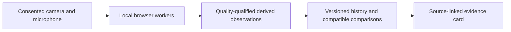

# PhenoMetrix

**Face and voice measurements with inspectable evidence.**

PhenoMetrix turns consented audiovisual signals into versioned measurements,
compares compatible observations over time, and presents the result for human
review. It is a **nonclinical research prototype**, built around local signal
processing, explicit quality limits, and reproducible ML experiments.

A telehealth conversation contains observable changes in facial movement and
voice. Turning those signals into useful measurements requires distinguishing
changes in the person from changes in the microphone, lighting, task, or software.
PhenoMetrix records those conditions and withholds measurements when the evidence
is insufficient. Clinical interpretation and utility require separate validation.

## Three capabilities

| Capability | What it does |
| --- | --- |
| **Ambient Capture** | Processes consented face and voice signals independently, checks source quality, and returns measured or reason-coded withheld outcomes. The current registry contains 20 facial and 7 voice metrics. |
| **Personal Trajectory** | Selects compatible prior observations, preserves inclusion/exclusion reasons, and computes transparent within-person comparisons. |
| **Clinician Evidence Card** | Connects each descriptive result to its source, protocol, versions, and uncertainty so a reviewer can inspect, correct, or dismiss it. |

The local demo supports independently consented captures and a page-memory
reference. The encounter integration adds durable derived observations,
versioned history, and scoped review. Medical contexts belong in separately
versioned protocol packs; an engineering measurement is not a diagnosis,
disease-severity score, or treatment recommendation.

## How it works



- **Local acquisition and bounded streaming.** Face processing uses MediaPipe
  in a worker. Audio flows through an AudioWorklet and a worker with fixed PCM
  and result credits. Dropped input, stale results, and discontinuities remain
  explicit gaps and reset feature history. Raw media and native model outputs
  do not enter durable observation payloads.
- **Time is part of the measurement contract.** Voice frames carry sample
  support, processing time, segment identity, and loss information. A same-clock
  lease requires a recorded software render-age bound of at most 100 ms before
  delivery. This bounds age since the last required rendered input; physical
  microphone latency, timestamp precision, and later display delay remain
  unqualified.
- **Deterministic analysis and durable provenance.** Shared TypeScript contracts
  connect capture, trajectory, and evidence. The encounter service uses scoped
  authorization, append-only PostgreSQL history, transactional analysis jobs,
  worker leases, and revision checks that prevent stale publication. Corrections
  create new versions rather than rewriting previous evidence.
- **ML experiments stay attributable.** The voice research pipeline uses the
  browser's feature extractor, PyTorch training, ONNX browser inference, frozen
  checkpoints and predictions, and independent scoring and inference audits.
  Candidate support, unavailable outputs, measurement delay, and failed
  advancement gates are retained alongside aggregate results.

**The default capture path uses the versioned DSP estimator. Learned estimators
remain research options.** The embedded API can attach to a host-owned patient
stream without taking ownership of the call. A deployed Zoom/EHR connection,
clinical authorization, and acquisition validation are not bundled. See the
[architecture](docs/architecture.md) and
[encounter integration guide](docs/encounter-integration.md).

## Evidence so far

The strongest completed results distinguish signal accuracy from software
correctness and runtime behavior:

| Evaluation | Result | What it establishes |
| --- | --- | --- |
| Frozen natural-speech evaluation | Hybrid joint error **9.67%**, DSP **11.85%**, original candidate MLP **9.12%** across 160 recordings from four previously reserved speakers and four fixed conditions | The MLP-voicing/YIN-pitch hybrid improves on classical comparators, while its own MLP remains better on mean natural error. Predictions froze before reference acquisition. |
| Expanded candidate pool with matched retraining | Development joint error **8.4589%**, versus **8.4020%** for the matched original pool; targeted 517.3/641.9 Hz selections remain **0/112** despite correct candidates on every post-change frame | Preserving the original candidates and retraining does not resolve selection errors. Unchanged advancement gates reject the expanded pipeline. |
| Python/browser arithmetic parity | **15,232 analytic and natural-input frames**, zero final-state mismatches after one declared numerical repair | Agreement on fixed input windows under unchanged tolerances. The original failed comparison remains recorded. |
| Sustained browser replay | **30 minutes**, **179,923 certified frames**, complete-block p99 **6.1 ms**, maximum recorded software age bound **54.4 ms** | Bounded transport and recovery from injected worker/main-thread stalls on the tested local configuration. |
| Exposure versus acoustic evidence: four arms, three seeds | Targeted exposure clears **78/78 analytic gates in every seed**, versus **72/78** with existing exposure; candidate development joint error is **8.4135%**, versus original MLP **8.6349%** | Targeted training repairs retained pitch-selection failures. The **0.2214 percentage-point** natural-error improvement misses the required **0.5-point** gate; promotion remains a no-go. Saved results survive a preserved terminal reporting failure. |

Natural joint error counts incorrect voicing, unavailable outputs, and pitch
errors greater than 50 cents. Results average speakers and conditions equally.
These research estimators use 40 ms windows with **20 ms measurement delay**,
which is separate from processing latency. The natural references are
laryngograph-derived PTDB-TUG labels; this is one corpus, not external clinical
validation. The reserved sample is now consumed and cannot serve as a fresh
holdout again. Some transformed-speech strata remain substantially worse than
the aggregate. The expanded-pool figures use reused development speech and
are not directly comparable to the reserved-speaker results.

The browser run was a source-frozen functional replay on an Apple M4 Max with
128 GiB RAM, not a controlled hardware benchmark or a real-microphone latency
study. Queue bounds do not establish whole-browser heap bounds. Full methods,
strata, failures, uncertainty, and timing definitions are in the
[natural-speech and browser validation report](research/voice-prosody/HYBRID_VALIDATION_RESULTS.md).

The ML research separates three sources of error: whether the correct pitch is
available, whether the model selects it, and whether the output is reliable
enough to report. Earlier augmentation repaired specific harmonic-balance
failures, but adding correct candidates and retraining still left systematic
selection errors. The [expanded-pool study](research/voice-prosody/EXPANDED_POOL_RESULTS.md)
records those failures alongside its modest increase in candidate coverage.

A [frozen four-arm, three-seed study](research/voice-prosody/EXPOSURE_STUDY_RESULTS.md)
now separates targeted training exposure from one compact causal acoustic
feature. Using the audited 1,536-configuration TRAIN bank, targeted exposure
repairs the retained 517.3, 633.1 and 641.9 Hz failures with the feature either
off or on. The feature alone does not repair them, and adds only a small natural
error reduction. This supports improving training exposure within this study;
it does not show that acoustic evidence is unnecessary in general.

All four arms also succeed on all twelve fresh synthetic configurations, so
those cases do not distinguish the interventions. The natural development set
is reused, and the synthetic bank remains narrow, noiseless and associated with
frequency. No external or untouched-speaker generalization is established.
The run saved all twelve checkpoints, frozen predictions and metrics, then
failed while printing its final summary. That execution failure remains
preserved. A separate audit verified **3.26 million frame-model comparisons**
with zero state or pitch mismatches, without repeating fits or generating more
cases. The [prior support no-go](research/voice-prosody/EVIDENCE_RESULTS.md),
[TRAIN coverage study](research/voice-prosody/FREQUENCY_DIVERSITY_RESULTS.md), and
all observed failures remain part of the evidence.

**The learned estimator remains a no-go for promotion.** Voicing and candidate
probabilities are uncalibrated; benchmark improvements do not establish clinical
usefulness or qualify a learned estimator for the default path.

## Run locally

Use Node 22.12+ on the Node 22 line or Node 24+, pnpm 9.12.3, and Chrome on macOS.

```sh
pnpm install --frozen-lockfile
pnpm dev
```

Open **http://127.0.0.1:4173** for the live local demonstration. Camera and
microphone consent are independent. The page-local reference is discarded on
reset, visibility loss, or reload; it is not durable clinical history. Use
synthetic participants for development.

```sh
pnpm dev:evidence  # synthetic evidence-card preview on port 4175
pnpm test          # structure checks, unit tests, TypeScript, and builds
```

The [service guide](apps/encounter-service/README.md) covers PostgreSQL and
`pnpm dev:encounter`. The [research guide](research/voice-prosody/README.md)
provides the pinned Python environment, corpus/provenance rules, reproduction
commands, and exact validation receipts. Browser suites, PostgreSQL tests, and
the optional disconnected voice sidecar have separate prerequisites documented
there and in the integration guides.

## Explore the repository

| Area | Start here |
| --- | --- |
| Product direction and boundaries | [Platform vision](docs/telehealth-platform-vision.md), [validation](docs/validation.md), [safety](docs/safety.md) |
| Capture and streaming | [Browser app](apps/capture-web), [voice foundation](docs/voice-foundation.md) |
| Measurements and contracts | [Ambient core](packages/ambient-core), [contracts](packages/contracts) |
| Longitudinal evidence | [Trajectory core](packages/trajectory-core), [evidence core](packages/evidence-core), [review panel](apps/clinician-review) |
| Host integration and persistence | [Encounter service](apps/encounter-service), [integration runbook](docs/encounter-integration.md) |
| ML experiments and reproducibility | [Voice research](research/voice-prosody/README.md), [public aggregate evidence](benchmarks/voice-prosody) |

Routine capture retains derived observations through the governed service.
Research-media retention requires separate consent and is disabled by default.
No clinical validation, autonomous clinical action, or production deployment is
established by this repository.
