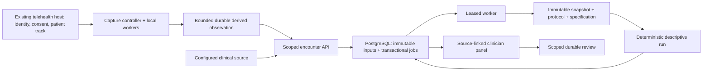

# PhenoMetrix architecture

The repository implements an ambient encounter integration substrate and retains
the original local ObservationV3 demo. Both serve the same three capabilities:
Ambient Capture, Personal Trajectory, and Clinician Evidence Card. Neither has
clinical validation. See the [integration runbook](encounter-integration.md) for
deployment interfaces and the [platform vision](telehealth-platform-vision.md)
for longer-term scope.

## Existing-host encounter path

A host supplies its authenticated session, encounter identity, participant track,
and explicit modality-specific consent. `packages/encounter-client` retrieves
the scoped capture context and submits derived observations. The browser entry
points are `apps/capture-web/src/embedded-encounter.ts` and
`integrated-encounter.ts`. They add no device prompt, patient login, questionnaire,
or capture screen. Provider review is optional and does not block the visit.

`packages/encounter-capture` owns capture authorization, participant attribution,
modality availability, stale-result rejection, and resource bounds. Its local
adapter attaches analysis to existing host media; it does not own the call's
tracks. Page visibility does not define encounter end. Host lifecycle and
authorization updates must be delivered to the controller.

The RTMS adapter is a reference transport with explicit participant selection,
handshake checks, and unsupported-format abstention. It supplies no qualified
RTMS measurement processor. The HFS protocol currently permits local pre-codec
and synthetic sources, not platform patient tracks. A real Zoom installation,
permissions, webhook trust, credentials, and acquisition validation remain
external integration work.

## Media and measurement boundary

The audio worklet transfers nominal 20 ms PCM blocks through a four-credit
buffer pool to a worker with a two-second ring. Matched worker-v3/worklet-v2
messages carry exact support endpoints, capture epoch, clock-mapping identity,
and drop counters; compact acoustic frames remain v1 and DSP remains 1.1.
Face inference uses MediaPipe inside a worker. Native bitmaps, landmarks,
transformation matrices, and raw PCM do not enter durable observations.
Blendshapes are disabled. Only compact signal/geometry and quality primitives
reach the deterministic extractor.

Voice timing v2 preserves the fixed AudioContext-to-main projection as an
unqualified diagnostic and converts worker performance timestamps using both
realms' time origins. Legacy window-start times remain unchanged; additional
records declare support end, required samples, service time, and result arrival.
Unknown accuracy and inconsistent or negative durations remain explicit. These
local coordinates are separate from authenticated UTC clock qualification below.
Acquisition metadata and rendered PCM rate are distinct.

Production and browser research replay require a render-freshness lease. Main
issues it for 100 ms, and the worklet snapshots it before the first sample of a
PCM block; renewal never refreshes earlier partial support. Worker admission
checks lease identity and expiry, and the host verifies the exact issued lease
in its original clock before delivery. The resulting upper bound is main receipt
minus main issue time for the last required rendered input. It does not qualify
physical microphone time, timestamp precision, earlier window samples, or later
application/display delay. Fixed audio projections no longer authorize age.
The main issuer targets 25 ms renewal, permits only one outstanding control
request, and keeps at most eight issued identities. Timeout cannot create credit.

Voice transport drops new blocks when PCM credits are exhausted. Missing input,
missing/expired leases, and dropped samples remain explicit gaps. Discontinuities
reset all feature history and start new segments. Stop waits at most 500 ms for
a final worklet loss snapshot and worker acknowledgement; timeout is explicit,
and the snapshot retains outstanding credits and terminal partial-sample loss.
Worker-to-main transport separately admits at most four acknowledged result
batches, with bounded frame/diagnostic data and a timing-completion envelope.
Result backpressure drops input and resets history. The host decides freshness
and returns credit before callbacks, counts expired/withheld results, and requires
a fresh segment after loss. All terminal paths remain independent of result
credit. Downstream application storage and total browser heap are outside these
queue bounds. See [voice foundation](voice-foundation.md) for exact timing,
lease, reset, and teardown semantics, and
[the timing follow-up](../research/voice-prosody/TIMING_FOLLOWUP.md) for evidence.

The generic ambient registry contains 7 voice and 20 facial metrics. Extractors
screen qualified voice segments and facial bins, returning measured or withheld
outcomes with source windows and reasons. No transcript, embedding, or generated
clinical narrative is involved.

The encounter bridge rotates at most five-minute derived windows throughout a
longer visit. It rebases each window's analysis clock while retaining acquisition
timestamps, disposes transient primitives, and does not invent measurements in
gaps. Automatic facial calibration uses available qualified frames. Voice uses
a host noise reference or versioned passive screening of sufficiently long,
stable acoustic intervals; missing conditions withhold voice readiness. Both
noise-reference methods have explicit engineering-only provenance. Continuity
loss closes prior evidence before recalibration, and pre-calibration frames
cannot be qualified retroactively. Capture source and
processor versions are compatibility inputs. Device settings cannot establish
hardware identity or acquisition validity by themselves.

The integrated host entry point obtains three scoped authenticated clock probes
before capture and renews automatically before expiration. A separate trusted
clock monitor must attest the server's UTC error; its wall clock alone is
insufficient. The client conservatively combines round-trip time, source error,
timestamp resolution and a bounded drift allowance. Capture keeps one monotonic
timestamp mapping and accumulates uncertainty across renewals. Missing initial
qualification records an explicit uncertainty sentinel; a new offset cannot be
adopted halfway through a visit. Expiry, source changes or clock discontinuity
stop analysis. Synthetic clock evidence cannot qualify live acquisition.

Delivery waits briefly when needed to respect the service's knowledge-time
boundary. A transient upload retries the identical revision with bounded delay
and cancellation; exhausted delivery propagates to stop the measurement branch.
Final delivery remains cancellable by withdrawal after the encounter ends.

## Durable contracts and storage

The new contracts live in `packages/contracts/src/treatment-response.ts`.
They are separate from the unchanged legacy v3 schema:

- `DurableObservationV1`: scoped encounter, consent/binding references,
  measurement protocol, capture provenance, bounded evidence windows, terminal
  metrics, and explicit correction identity.
- Consent and participant binding: scoped authorization with modality limits
  and immutable envelope versions in the service.
- Treatment/context revisions: effective clinical time distinct from recorded
  knowledge time, date precision, source identity, product-specific dose units,
  cycles, concurrent context, and retractions.
- Protocol/specification: sealed intended use, metric definitions, source
  compatibility, baseline/phase rules, and prohibited claims.
- Snapshot/run/review: content-addressed analytical inputs/results and review
  bound to an exact run and digest.

`apps/encounter-service` uses PostgreSQL for episode metadata, append-only source
envelopes, immutable evidence, and reviews. A source write and its analysis job
commit in one transaction. Revision checks protect validation against concurrent
changes. Worker leases and input-revision fences prevent stale publication.
Expired leases can be reclaimed; repeated analysis failure becomes explicit
failed state. Replaying an old run requires its source revision and explicit
analysis time, including the authorization versions known then.

Authentication verifies signed issuer/audience and tenant, study, participant,
role, permission, and data-class claims. These claims must come from the host's
trusted identity integration. They do not provide enrollment or identity proofing.
Evidence retrieval checks current authorization and the actual source consents;
an unrelated new grant does not reopen withdrawn evidence.

FHIR ingestion is a bounded configured-source integration, not a general EHR
installation. Complete administrations and mapped procedures may establish
treatments; orders remain planned and medication statements remain context.
Source versions, receipt time, original dates, dose units, and unknown/day/exact
precision are preserved. Terminology, timezone mapping, patient matching, remote
credentials, and source provisioning require deployment configuration.

## Descriptive treatment alignment

`packages/trajectory-core/src/treatment-response.ts` is a pure deterministic
analysis over a sealed immutable history snapshot, protocol, and specification.
It does not query a database, call an LLM, infer an injection from conversation,
or execute a clinical action.

The first HFS research protocol selects existing left/right eye aperture and
left/right lid closure completeness. It does not detect or quantify spasms.
Its default engineering baseline uses at least two independent pretreatment
encounters within 56 days and a median of encounter medians. Follow-up phase
coverage extends to 112 days. These windows and thresholds are not validated
clinical recommendations.

The engine enforces scope, consent, binding, exact source/context/version
compatibility, quality, and chronology. It reports exclusions explicitly,
preserves treatment-date uncertainty, flags concurrent context and prior-cycle
carryover, and prevents index-cycle pooling across a subsequent injection.
Unknown or unverified treatment anchors retain qualified calendar measurements
without treatment-relative timing or baseline deltas.

Each run freezes its selected baseline and source versions. Corrections create a
new run while the previous run remains immutable. Sparse coverage and unknown
measurement error remain explicit. There are no fitted response curves,
interpolation, causal efficacy estimates, or clinical significance thresholds.

## Evidence and optional research media

`packages/evidence-core` creates a deterministic source-preserving projection.
`apps/clinician-review` provides an embeddable panel with calendar/treatment-time
views, native-unit points, exclusions, coverage, and per-point source/quality
inspection. Loading, pending, missing, withdrawn, and failed states are explicit.
The panel can use the existing-host service client. Durable clinician review
binds the authenticated actor to the exact evidence run.

`packages/research-governance` is a separate disabled-by-default clip boundary.
It requires separate research consent, scope/observation authorization, encrypted
storage, durable metadata, audit, retention limits, and deletion handling.
Routine capture does not invoke it. No production blob store, patient clip flow,
or institutional research approval is supplied. Access denial and physical
deletion are distinct operations; deployment retention workers and backup policy
must cover the latter.

A separate local `research-voice.html` entry point uses synthetic AudioBufferSource
replay through the production worklet/worker, optional exported-model parity
checks, and explicitly selected candidate-MLP or MLP-voicing/YIN-pitch research
modes. Production capture remains DSP-only. The hybrid pins the original
checkpoint and configuration bytes, computes raw YIN for each exact prepared
window, and combines it with frozen MLP voicing without a candidate-selection
or extra confidence gate. Every research result, including host-withheld results,
retains configuration/model/estimator identities. The optional research hook reuses shared v2 features
and the original DSP baseline, then serializes single-thread pinned ONNX/WASM
inference with one active plus three queued PCM requests and the same four
result credits. Model probabilities remain separate from heuristic confidence;
reset/disposal invalidates both late predictions and late errors. Full-block
and main-arrival timing include model completion, while inference-only timing
is separate. The route requests no microphone, does not connect a learned
estimator to production measurements, and streams bounded raw timing batches
to a local test sink. It is an engineering research harness within Ambient Capture, not another
product capability or a retained patient-media path. A separate bounded PCM
fixture worker calls the same hook for natural-speech arithmetic parity on the
provider frame grid; those checks are distinct from actual worklet streaming
and from reference-scored independent natural accuracy.

## Legacy local demo retained

`pnpm dev` serves the original static browser demo. A participant asserts an
affected side, consents to separate device permissions, completes calibration,
and captures up to five minutes. Acquisition is disposed before the
ObservationV3 report is displayed. The generic report contains 27 outcomes.

The first live observation can be explicitly accepted in page memory, followed
by an independently consented second capture. The legacy comparator checks
subject, side, profile, protocol, metric, and processor compatibility before
showing six fixed facial rows and raw current-minus-reference differences.
Withheld/incompatible sources have no numeric delta. Accept/dismiss is local
demo state, not authenticated clinical review.

Reset, visibility loss, and page exit erase this demo's reference/report state.
This teardown policy is intentionally different from the embedded host path,
whose call continues when hidden. Legacy capture does not call the new service.
The old v2 history implementation remains removed; guided examples are archival.
The optional WavLM service is disconnected and disabled by default.

## Deployment and validation limits

Static asset checks establish delivery self-consistency. A trusted manifest and
binding checked bytes to executed assets still require deployment integrity work.
A short actual-browser synthetic voice replay has functional evidence for
sample support, bounded PCM/result/lease credits, worker/main overload drops,
software freshness certificates, segment recovery, terminal accounting, and a
known periodic tone. The historical 30-minute run used the prior fixed-clock
gate; its timing findings and the new lease confirmation are reported separately.
Neither establishes hardware-input delay, total browser heap bounds, or
natural-speech accuracy.
Real-device timing, host-track identity, broader browser lifecycle behavior,
platform quality, and measurement repeatability still require acceptance and
validation. The voice foundation records the evidence identity and prepared
30-minute lease-confirmation command; completion and limits belong to the
versioned timing report.

No analytical or clinical validation, clinically meaningful change threshold,
scale equivalence, dose recommendation, emergency screening, or automated
clinical action is implemented. See [validation.md](validation.md).

## Offline candidate-selector research boundary

The step-1 selector study is confined to `research/voice-prosody`. Its versioned
contract and gates are declared in [SELECTOR_EXPERIMENT_PLAN.md](../research/voice-prosody/SELECTOR_EXPERIMENT_PLAN.md).
`selector_headroom` validates frozen train/development evidence; `selector_model`
implements pitch-only slot and shared-candidate scorers; `selector_experiment`
separates prerequisite audits, local MPS fitting, prediction freeze and scoring.
Frozen original MLP voicing is external and identical across all new arms.
Grouped outputs are original candidate frequencies with preserved source/member
provenance; their losses use actual emitted frequencies. These offline checkpoints
are not browser assets or production estimators. The failed advancement gate is
recorded in [SELECTOR_RESULTS.md](../research/voice-prosody/SELECTOR_RESULTS.md).

The bounded harmonic-context follow-up adds `harmonic_selector_model` as an
offline shared-scorer subclass, retaining the same candidates, grouping, targets
and external voicing. Its absolute/relative context arms allocate identical
parameters and differ only in the supplied frequency-ratio feature.
`harmonic_challenge` requires an exact twelve-checkpoint/source freeze before
generating prospective waveform inputs through the unchanged TypeScript replay.
`recover_harmonic_scores` is a score-only recovery of the retained post-freeze
JSON error; independent score, inference and bottleneck auditors bind the
lineage. These components remain outside browser assets and production; both
natural advancement and prospective challenge gates failed. See
[HARMONIC_RESULTS.md](../research/voice-prosody/HARMONIC_RESULTS.md).

The subsequent `subharmonic_objective` component supplies TRAIN-only negative
masks and auxiliary losses to the unchanged relative-context selector. Its
symmetric harmonic relationships use actual emitted candidate frequencies and
existing acceptable labels; neither references nor margin rules enter inference.
`subharmonic_experiment` freezes nine checkpoints and every prediction before
scoring; `subharmonic_challenge` adds a new source-bound generation contract while
preserving the old challenge as required regression. Separate arithmetic,
checkpoint-replay and region-coverage auditors verify the artifacts. This remains
offline research: the partial 337.1 Hz repair and new 354.5 Hz failure do not pass
advancement gates. See [SUBHARMONIC_RESULTS.md](../research/voice-prosody/SUBHARMONIC_RESULTS.md).

The `augmentation_cases` component defines paired stationary and harmonic-balance
TRAIN signals plus a separate prospective evaluation grid. TRAIN generation
requires the source/specification freeze; evaluation generation requires all nine
final checkpoints. The `augmentation_experiment` runner retains the existing
selector, natural-only scaling and natural optimizer schedule, adding a fixed
synthetic loss inside the same update for the two augmentation arms. Target and
sampling artifacts preserve uncovered rows and paired exposure. Independent
score, inference and coverage auditors reconstruct the saved evidence. This
boundary remains offline research; the experiment cannot change browser capture
or promote a model. See the [augmentation plan](../research/voice-prosody/AUGMENTATION_EXPERIMENT_PLAN.md)
and [results](../research/voice-prosody/AUGMENTATION_RESULTS.md).

The no-fit candidate-coverage study adds a research-only `coverage_peaks.ts`
worker with a finite-PCM/endpoints interface. It reproduces the original full40
maximum, then retains the shortest already-admitted maximum under unchanged
thresholds and interpolation. `candidate_coverage_features` replaces only that
source channel, preserves legacy/suffix evidence and records candidate eviction.
The six-candidate layout remains fixed. The experiment runner uses the same
three frozen balance-augmentation selectors and original-feature MLP voicing;
revised inputs never enter the voicing head. `coverage_cases` binds twelve new
configurations to the source/checkpoint freeze, and predictions freeze before
reference scoring. Independent score and equation-replay auditors verify both
policies and all 62 cases. This boundary remains offline: repaired target
coverage does not repair selection, natural error rises, and unchanged gates
reject advancement. See the [candidate-coverage plan](../research/voice-prosody/CANDIDATE_COVERAGE_PLAN.md)
and [results](../research/voice-prosody/CANDIDATE_COVERAGE_RESULTS.md).

The additive-pool follow-up isolates a new research boundary in
`expanded_candidate_features`: original six-candidate frequencies and source
evidence remain, with at most one additional admitted full-window peak in a
versioned seven-slot schema. `expanded_selector_model` accepts six or seven
candidates with the same 3,009-parameter equations; both training arms use
original-six natural-TRAIN scaling and original-feature MLP voicing. Group
representatives remain observed members. Raw retention is guaranteed, while
regrouping losses are measured separately.

`expanded_pool_experiment` freezes sources, input caches, reference-based
candidate prerequisites and matched training schedules, then six final
checkpoints before `expanded_cases` generates twelve prospective configurations.
Consumed development references are used for declared prerequisite pass/stop
checks before training and reloaded for final scoring only after predictions
freeze; this does not claim globally blinded development evaluation. All 62
prior analytic cases remain. Independent score and target-free equation auditors
verify retention, grouping, training exposure, outputs and unchanged gates.
This is an offline experiment without production promotion or new browser
qualification. See the [fixed plan](../research/voice-prosody/EXPANDED_POOL_PLAN.md)
and [results](../research/voice-prosody/EXPANDED_POOL_RESULTS.md).

The exposure/evidence study adds research-only `periodicity_evidence` kernels
in TypeScript and NumPy. Their contract uses the existing trailing 1,920 samples
at 48 kHz and the actual emitted grouped candidate frequency, returning period
correlation, subperiod contrast, and explicit validity. Grouping happens first;
no future samples, candidate eviction, or new voicing inputs are introduced.
`evidence_selector_model` adds a zero-initialized three-weight residual while
preserving the base scorer and original MLP voicing. `evidence_feasibility`
checks TRAIN support before schedules or fits; `evidence_experiment` binds source,
input, schedule, checkpoint, and prediction chronology for a prospective 2×2×3
comparison. A failed prerequisite blocks every dependent scientific stage.

Independent `audit_evidence_feasibility` and `audit_evidence_scores` modules
reconstruct support and verify source/artifact/repair identities, distinguishing
an audit pass from a scientific pass. `local_evidence_report` produces a local,
self-contained HTML view from hash-bound saved evidence, with unavailable model
outcomes explicitly unassessed. The saved study stopped at insufficient carrier
support with zero fits or fresh evaluation cases. No model export, default DSP
change, or browser qualification occurred. See the
[results](../research/voice-prosody/EVIDENCE_RESULTS.md).

The separate `frequency_diversity` producer is a terminal TRAIN-only support
study. It refines a fixed integer-microhertz carrier lattice and generates only
1,536 new synthetic configurations; the previous 512 remain a hash-bound,
already-observed baseline. The existing synthesis, original candidate extractor,
additive seven-candidate pool, grouping, support window, and correctness
thresholds remain unchanged. Sources, specification, plan, and the external
resource supervisor are frozen before generation. PCM, feature arrays, and full
per-frame ledgers remain in ignored local research storage.

`audit_frequency_diversity` independently enumerates the configuration metadata,
checks the bijection between carrier indices and numeric frequencies, and
reconstructs candidate retention, grouping, timing, coverage, and both targeted
support strata. Distinct IDs cannot inflate frequency diversity. The primary
support decision uses the new bank alone under the unchanged floors. Any
old-plus-new summary is descriptive and cannot rescue a failing primary result.
The audit distinguishes source/artifact consistency from adequate TRAIN support;
neither establishes learnability or natural-speech generalization.

This producer stops after its support report on either PASS or FAIL. It has no
sampling-schedule, fitting, learned-inference, natural-reference, fresh-evaluation,
export, or browser phase. A support pass does not authorize those stages or
change a prior advancement decision. The default DSP estimator and production
capture path remain unchanged. See the
[TRAIN-only study plan](../research/voice-prosody/FREQUENCY_DIVERSITY_PLAN.md).

The separately versioned `exposure_study` runner consumes the audited refined
TRAIN bank through `exposure_inputs`; it does not regenerate that bank or alter
the preceding coverage experiment. It crosses existing versus targeted exposure
with the unchanged periodicity feature off versus on, under matched schedules,
initialization and optimization. The predesignated candidate is fixed before
fitting. Sources, prepared inputs and schedules, all twelve final checkpoints,
and all predictions have separate ordered freezes. Reserved analytic inputs
are generated only after the complete checkpoint freeze validates.

`audit_exposure_study` independently reconstructs sampling, targets, model
outputs, scores and conjunctive gates, while a fixed sample of saved TRAIN
windows checks the acoustic channels against raw PCM. Scientific success,
artifact consistency and resource observations remain separate results. A
prerequisite or execution failure terminates dependent work and preserves its
attempt; it does not authorize a retry or revised evaluation set. This remains
an offline research boundary with no model export, browser qualification or
default DSP change. See the
[prospective study plan](../research/voice-prosody/EXPOSURE_STUDY_PLAN.md).

The first exposure-study attempt retains a failed terminal state after a final
stdout serialization error, despite saved checkpoints, predictions and metrics.
A separate post hoc forensic audit qualifies those saved artifacts using the
frozen independent equations and the actual failed manifest. It cannot rewrite
the attempt status, regenerate evaluation inputs, refit models or change gates.
